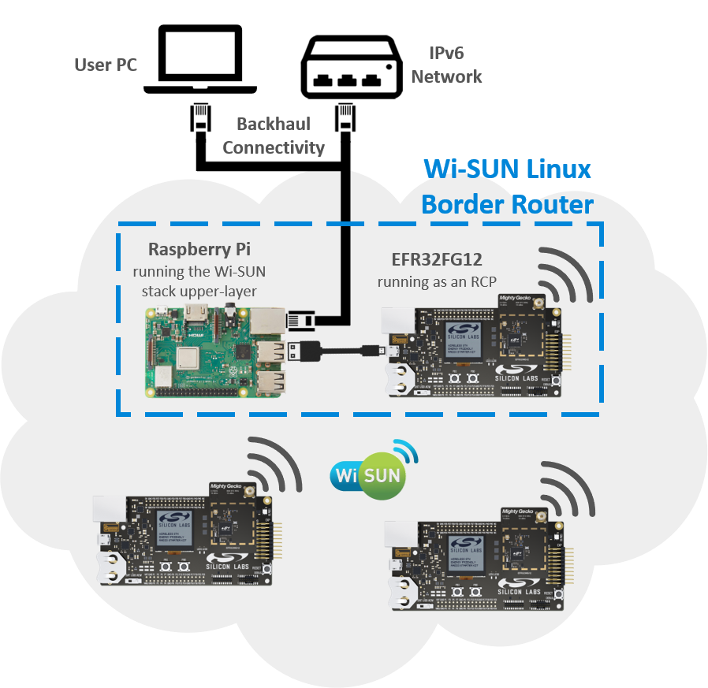
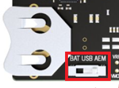

# Wi-SUN - RCP Border Router

The Wi-SUN RCP Border Router application is a radio coprocessor implementation that has to be paired with a Linux host running the Wi-SUN stack upper layers (i.e., wsbrd).

## Getting Started

To get started with Wi-SUN and Simplicity Studio, see [Developing with Wi-SUN](https://docs.silabs.com/wisun/latest/wisun-start/).

The RCP term stands for "radio coprocessor", meaning the application runs on the EFR32 and requires an external Linux host. The Linux host has to run the [wsbrd daemon hosted on GitHub](https://github.com/SiliconLabs/wisun-br-linux). Using both the linux host and the EFR32 running the RCP image, the aim is to create a Wi-SUN border router that can scale to support large network deployments.

## Project Configuration

Before building and flashing the RCP firmware in Simplicity Studio (`.slcp` Software Components), apply the following configuration changes:

1. **Disable CPC Security**
   * **Action:** Set `SL_CPC_SECURITY_ENABLED` to `0` (disabled).
   * **Reason:** Disables encryption/authentication overhead on the host-to-RCP serial link, avoiding key-provisioning mismatches during initial bring-up and ensuring compatibility when `wsbrd` is configured without CPC security (`cpc_security = false`).

2. **Install `CPC Secondary - UART`**
   * **Baud Rate:** `115200`
   * **Flow Control:** Disable hardware flow control (`CTS/RTS` set to None).

3. **Increase CPC RX Buffer Count**
   * **File:** `config/sl_cpc_config.h`
   * **Setting:** Set `SL_CPC_RX_BUFFER_MAX_COUNT` to `3` (must be greater than `2` to prevent frame drops under concurrent Wi-SUN traffic).

4. **Install `RAIL Utility, RF Path (RAIL 3)`**
   * **RF Path Mode:** Set to `Path 1`.

  

5. **Install `RAIL Utility, RF Path Switch Control (RAIL 3)`**
   * Ensure this component is installed (add it manually if it is not already present in the project) and map the control pins (`SL_RAIL_UTIL_RF_PATH_SWITCH_RADIO_ACTIVE`, etc.) to match your board schematic.
     
  

6. **Install `Radio Utility, FEM`**
   * Download and enable the Front-End Module (FEM) utility component to configure the external PA/LNA control signals.
   
  
  

## Troubleshooting

Before programming the radio board mounted on the WSTK, ensure the power supply switch is in the AEM position (right side), as shown.

## Report Bugs & Get Support

You are always encouraged and welcome to ask any questions or report any issues you found to us via [Silicon Labs Community](https://community.silabs.com/s/topic/0TO1M000000qHc6WAE/wisun).
